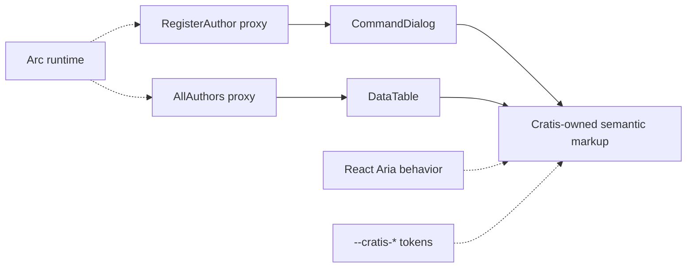

import { Steps, Aside } from '@astrojs/starlight/components';

Configure **Components**, the React UI component of Cratis Platform, then open an add-author dialog against a running Arc backend. By the end of this page you can enter a name, execute the generated `RegisterAuthor` command, and distinguish success from a rejected command. To build the list and selected author's books around it, continue with the [library tutorial](/components/tutorial/).

This page follows the generated-proxy path. Components does not generate proxies or start a backend. For local arrays or controlled input without backend requests, [choose a local-data surface](/components/choosing-a-component/) instead; the package peer requirements still apply. Chronicle is not required.

## Prerequisites

- A React 19 application built with TypeScript. Components declares `react` and `react-dom` `^19.0.0` as peers.
- An Arc frontend with generated proxies and `experimentalDecorators`/`emitDecoratorMetadata` enabled. The [Arc tutorial's first slice](/arc/tutorial/first-slice/) sets up the project, `tsconfig.json`, and Vite proxy that this page assumes.
- `@cratis/arc` and `@cratis/arc.react` in the range `>=20.3.1 <23`. This checkout pins its Arc development dependencies to **22.153.1**. The wider peer range is not a claim that every accepted version is exercised.

Keep the Arc backend running and retain the Arc tutorial's development-server routing. Check that `src/Authors/RegisterAuthor.ts` exports the generated `RegisterAuthor` command with required `id` and `name`. The later table chapter also needs `AllAuthors` from `src/Authors/Author.ts`. If an export is missing, finish the backend slice and regenerate proxies rather than writing a substitute command class.

## Install and wire it up

<Steps>

1. **Install Components.**

    ```bash title="Install Components 4"
    npm install @cratis/components@^4
    ```

    React Aria, the internationalized date implementation, and React Icons are internal dependencies. The package does not depend on PrimeReact or any other UI kit or theme runtime, and you don't configure an icon package. The optional MUI and PrimeReact integrations are separate [renderer adapter](/components/renderers/) packages.

    The package requires React, Arc, Fundamentals, and `reflect-metadata` as peers. `tsyringe` is an optional peer: Components never imports it, and Arc React installs it as its own dependency. Keep `@cratis/arc` and `@cratis/arc.react` on the same version your generated proxies were produced with. A strict installer can install the required peers explicitly (replace the Arc version with the one your backend uses):

    ```bash title="Install explicit peers"
    ARC_VERSION=22.153.1
    npm install @cratis/components@^4 \
      "@cratis/arc@$ARC_VERSION" "@cratis/arc.react@$ARC_VERSION" \
      @cratis/fundamentals@^7.19.2 react@^19 react-dom@^19 \
      reflect-metadata@0.2.2
    ```

    Use Arc 22.16.0 or newer if you plan to use `AutoCommandForm`'s explicit field binding.

    `pixi.js@^8.20.0` is another **optional** peer, needed only if you use `Canvas` or `PivotViewer`. Every other component needs nothing beyond the required peers above; install Pixi later, when you reach a spatial workspace or card-grid screen. See [Choosing a component](/components/choosing-a-component/#spatial-workspaces).

2. **Create the CSS entry file**, keeping the package imports in this order:

    ```css title="src/index.css"
    @import '@cratis/components/tokens';
    @import '@cratis/components/styles';
    @import '@cratis/components/theme'; /* optional baseline appearance */
    ```

    Import that local file once from your application entry, alongside `reflect-metadata`:

    ```tsx title="src/main.tsx"
    import 'reflect-metadata';
    import './index.css';
    import { createRoot } from 'react-dom/client';
    import { App } from './App';

    createRoot(document.getElementById('root')!).render(<App />);
    ```

    `tokens` defines stable `--cratis-*` variables with conservative light defaults. `styles` supplies no-Preflight component structure in low-priority Cratis layers. `theme` adds automatic and explicit dark mode, forced colors, and themed subtrees.

    A product with its own design system can omit `theme`, map its own variables onto `--cratis-*`, and customize stable `data-cratis-part` elements or `pt` attributes.

    `styles` is every component's CSS in one file. To download only the surfaces you mount, import `@cratis/components/styles/base` plus one `<subpath>/styles` entry point per surface instead — see [Per-area stylesheets](/components/styling/per-area-stylesheets/).

    <Aside type='caution' title='Order matters'>
        Import `tokens` before `styles` and `theme` so every component resolves the same
        semantic variables.
    </Aside>

    This CSS-first path avoids TypeScript 6's `TS2882` for direct side-effect imports of the package's stylesheet subpaths, which ship no type declarations. Keep your bundler's CSS module types enabled; Vite projects normally reference `vite/client`. If a non-Vite setup needs a declaration for the local CSS import, add `declare module '*.css';` in a project-included `.d.ts` file.

    Existing applications can retain direct TypeScript imports of the three package stylesheets if they declare those subpaths once, for example in `src/cratis-components-styles.d.ts`. These declarations are an alternative to the CSS-first path, not an extra step required by it:

    ```typescript title="src/cratis-components-styles.d.ts"
    declare module '@cratis/components/tokens';
    declare module '@cratis/components/styles';
    declare module '@cratis/components/theme';
    ```

3. **Mount both providers** around your application. `<Arc>` supplies the command and query runtime the generated proxies use; `CratisComponentsProvider` supplies Components' locale, labels, and optional toast region. The Components provider does not replace `<Arc>` or configure the backend URL. Keep the Arc connection settings from your application. `Library` below is the handwritten component you will create later on this page:

    ```tsx title="src/App.tsx"
    import { Arc } from '@cratis/arc.react';
    import { CratisComponentsProvider } from '@cratis/components';
    import { Library } from './Library';

    export const App = () => (
        <Arc>
            <CratisComponentsProvider value={{ locale: 'en-US' }} toaster>
                <Library />
            </CratisComponentsProvider>
        </Arc>
    );
    ```

</Steps>

### Yarn PnP with Arc React 22.6.2

If you retain `@cratis/arc.react@22.6.2`, that version imports `rxjs` without declaring it. A strict Yarn PnP consumer needs `rxjs@7.8.2` and this version-specific package extension:

```yaml title=".yarnrc.yml"
packageExtensions:
    '@cratis/arc.react@22.6.2':
        dependencies:
            rxjs: '7.8.2'
```

This workaround is not needed with Arc React 22.16.0. Remove the old extension when upgrading; do not apply it to every Arc version.

## What the provider sets up

`CratisComponentsProvider` supplies the locale, Components-specific labels, and an optional app-wide toast region (`toaster`). React Aria uses the locale for date, number, keyboard, and screen-reader behavior. Styling remains CSS-owned rather than provider-owned. Every value is optional, so `<CratisComponentsProvider>` with no props also works. The full configuration surface is in the [CratisComponentsProvider reference](/components/common/cratis-components-provider/).



React Aria is an implementation dependency. Public props, parts, CSS variables, and event types are owned by Cratis.

## Localize Components labels

React Aria supplies its own locale data. Configure only labels owned by Components:

```tsx
<CratisComponentsProvider
    value={{
        locale: 'nb-NO',
        messages: {
            paginator: {
                navigation: 'Sidenavigasjon',
                first: 'Første side',
                previous: 'Forrige side',
                next: 'Neste side',
                last: 'Siste side',
            },
            datePicker: {
                today: 'I dag',
                clear: 'Tøm',
                openCalendar: 'Åpne kalender',
                previousMonth: 'Forrige måned',
                nextMonth: 'Neste måned',
            },
        },
    }}
>
    <YourApp />
</CratisComponentsProvider>
```

## See the payoff

`CommandDialog` takes the generated command, renders its fields and the OK/Cancel footer, keeps **Add** disabled until the form is valid, disables every button while the command executes, and closes only when the command succeeds:

```tsx title="src/AddAuthor.tsx"
import { useState } from 'react';
import { Guid } from '@cratis/fundamentals';
import { CommandDialog } from '@cratis/components/CommandDialog';
import { InputTextField } from '@cratis/components/CommandForm';
import { RegisterAuthor } from './Authors/RegisterAuthor';

export const AddAuthor = () => {
    const [id] = useState(() => Guid.create());
    return (
        <CommandDialog<RegisterAuthor>
            command={RegisterAuthor}
            title='Add author'
            okLabel='Add'
            initialValues={{ id }}
        >
            <InputTextField<RegisterAuthor> value={(command) => command.name} title='Name' />
        </CommandDialog>
    );
};
```

The `id` is required but not typed by the user, so it goes in `initialValues`: the command is complete except for `name` from the moment the dialog opens. Setting a required value in `onBeforeExecute` instead is a common mistake — that callback runs only after the form has validated, so **Add** would never enable.

Open the dialog with Arc's `useDialog` hook. It mounts the dialog only while it is open, so every **Add author** click gets a fresh `id`:

```tsx title="src/Library.tsx"
import { useDialog } from '@cratis/arc.react/dialogs';
import { AddAuthor } from './AddAuthor';

export const Library = () => {
    const [AddAuthorDialog, showAddAuthor] = useDialog(AddAuthor);
    return (
        <>
            <button type='button' onClick={() => void showAddAuthor()}>
                Add author
            </button>
            <AddAuthorDialog />
        </>
    );
};
```

Run the app, click **Add author**, and type a name. **Add** enables, the dialog executes `RegisterAuthor` when you confirm, and it closes once the backend reports success. If the backend rejects the command, the dialog stays open and shows the validation messages against the fields. **Cancel**, the close button, and Escape close it without executing.

Before continuing, check three outcomes: an empty required name prevents confirmation; **Cancel** closes without executing; a valid submission closes only on command success. Also try the flow with a keyboard and check the title, field label, and return focus in your application. A rejection is not a success: the dialog remains open, and server validation can be displayed against the fields.

No application `isExecuting` state or duplicate client validation logic is required for this flow. Generated types help detect contract changes; regenerate proxies when C# changes and update affected accessors. The next tutorial adds an observable table: seeing its new row is a separate query-result checkpoint, not something closing this dialog guarantees.

## Choose how it looks

Choose one styling posture:

- Import `theme` for the Cratis baseline.
- Define your own `--cratis-*` token values for a product design system.
- Add classes or ordinary HTML attributes through each component's Cratis-owned `pt` parts.
- Target stable `data-cratis-part` and state attributes when product CSS needs structural control.

Do not target React Aria class names or internal DOM structure. See [Styling](/components/styling/) and [Stable component parts](/components/styling/pass-through/).

## If something doesn't work

- **Add never enables** — check client validation and every required value, including hidden ids in `initialValues`. See [Troubleshooting](/components/troubleshooting/#the-command-submit-button-stays-disabled).
- **Components render unstyled** — the `tokens` and `styles` imports are missing or run after your product CSS in the wrong order. See [Troubleshooting](/components/troubleshooting/#components-render-without-styles).
- **Commands or queries never reach the backend** — check that `<Arc>` wraps the app and that its settings and your dev-server proxy match the backend routes. See [Troubleshooting](/components/troubleshooting/#commands-or-queries-do-not-reach-the-backend).

## Recap

You installed one UI package, imported Components-owned styles, mounted `<Arc>` and `CratisComponentsProvider`, and opened a command dialog generated from `RegisterAuthor`. Components owns the public React contract, Arc supplies command and query behavior, and React Aria supplies selected low-level interaction primitives internally.

Next, [build a live library screen](/components/tutorial/) — the tutorial guides you step by step through a list-and-detail page with query-backed tables and command dialogs.

## Where to go next

- [Build the library screen tutorial](/components/tutorial/) — follow one screen from a live table through command actions and list-and-detail composition
- [Building a form](/components/building-a-form/)
- [Displaying data](/components/displaying-data/)
- [Choosing a component](/components/choosing-a-component/)
- [Troubleshooting](/components/troubleshooting/) — installation, styling, rendering, and form symptoms
- [Migrate from Components 3](/components/migration/)
- [Understand the UI foundation](/components/ui-foundation/) — including the capability profiles and capability matrix behind Foundation, Advanced React, and Spatial components
