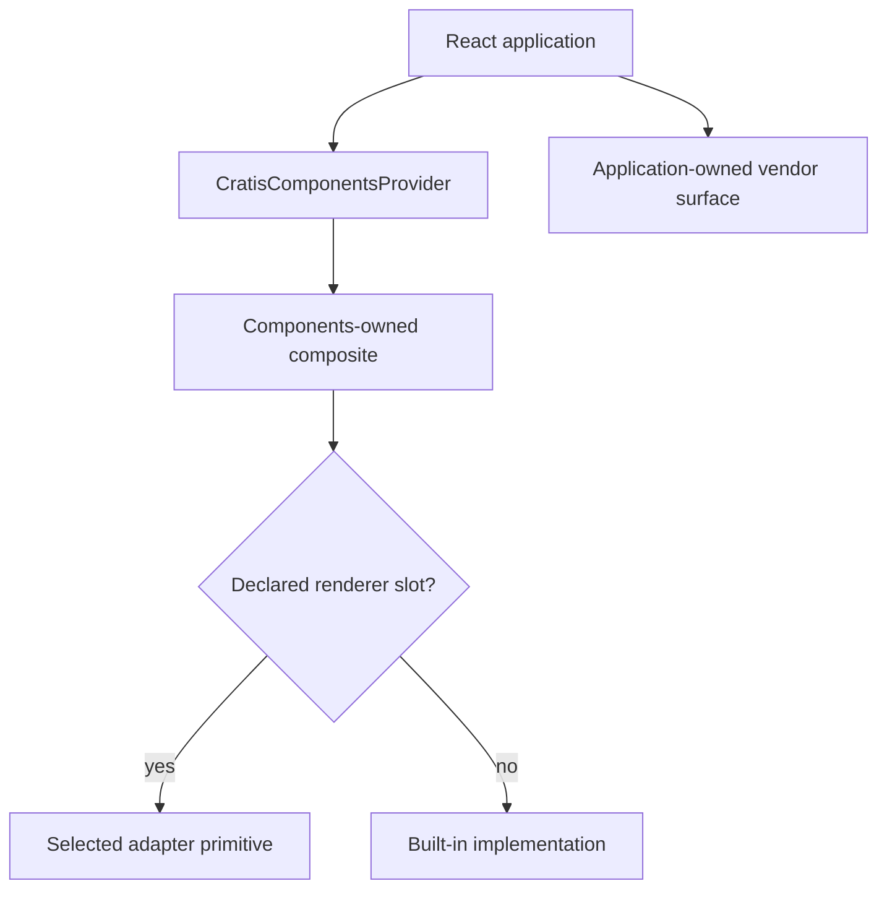

<!-- Copyright (c) Cratis. All rights reserved. -->
<!-- Licensed under the MIT license. See LICENSE file in the project root for full license information. -->

Cratis Components renderer adapters give nine common controls vendor presentation while Components
keeps ownership of its forms, tables, and larger compositions. Choose an adapter to change those
controls; build an application-owned vendor workflow when you need a vendor's grid or editing model.
You can use both approaches in the same React application.

## The ownership boundary

You do not need an adapter to use Components. Install `@cratis/components`, mount
`CratisComponentsProvider`, and omit `library` to use the built-in renderer. It uses semantic native
HTML for simple controls and React Aria internally for selected focus, collection, date, and overlay
behavior.

A renderer slot is a named place where Components can use an adapter's implementation of a control.
Each optional adapter below implements nine presentation slots, preserving the Components props and
behavior contracts:

| Package                           | Vendor peers                                                                                        | Declared coverage              |
| --------------------------------- | --------------------------------------------------------------------------------------------------- | ------------------------------ |
| `@cratis/components.mui`          | `@mui/material >=9 <10`, `@emotion/react >=11.5 <12`, `@emotion/styled >=11.11 <12`                 | Nine stable presentation slots |
| `@cratis/components.primereact`   | `primereact`, `@primereact/core`, `@primereact/ui` `>=11 <12`; `@primeuix/themes >=3 <4`            | Nine stable presentation slots |
| `@cratis/components.primereact10` | `primereact >=10.9.9 <11`                                                                           | Nine stable presentation slots |

Every adapter also has React and ReactDOM 19 as peers. Each published adapter release declares a peer on exactly its own version of `@cratis/components` (for example, `@cratis/components.mui@4.14.0` requires `@cratis/components@4.14.0`), so install and upgrade the adapter and `@cratis/components` together at the same version. PrimeReact is a peer of the two PrimeReact adapters only; `@cratis/components` itself depends on no PrimeReact package.

All three adapters declare `CratisPresentationUiLibrary` manifests for renderer ABI version 1, the versioned contract between Components and an adapter. They do not replace DataPage, DataTables, CommandDialog, CommandForm, Toolbar, Canvas, or another Components-owned composition. For example, selecting MUI can change a button inside DataPage without turning its table into a MUI grid. The [primitive adaptation reference](primitive-adaptation.md) lists the exact nine-slot profile; selecting it never replaces the full Components catalog.



The application renders a vendor grid alongside Components surfaces and supplies its data and
callbacks directly. Selecting an adapter does not route a Components table to that grid.

## Select an adapter

Pass the adapter's manifest to `library` on `CratisComponentsProvider`:

```tsx
import { CratisComponentsProvider } from '@cratis/components';
import { muiUiLibrary } from '@cratis/components.mui';

export const Application = () => (
    <CratisComponentsProvider value={{ locale: 'en-US' }} library={muiUiLibrary}>
        <main>Application content</main>
    </CratisComponentsProvider>
);
```

The example selects MUI presentation for the declared slots throughout this Components scope.
Controls outside that profile keep their built-in implementation by default. Complete the vendor
setup for the adapter you select:

| Adapter                           | Manifest                | Application setup                                                                                                                                                                                                     |
| --------------------------------- | ----------------------- | --------------------------------------------------------------------------------------------------------------------------------------------------------------------------------------------------------------------- |
| `@cratis/components.mui`          | `muiUiLibrary`          | Optional outer MUI `ThemeProvider`; the adapter reuses it, or MUI's default theme, as a CSS-variable theme. For server rendering, a request-local Emotion `CacheProvider` outside the Components provider.            |
| `@cratis/components.primereact`   | `primeReactUiLibrary`   | Required outer `PrimeReactProvider` from `@primereact/core/config` with the application's license key and theme, plus `rendererSetup` with `'cratis-primereact.license-configured'` set to `true` only when the key was supplied; see the [licensing policy](licensing.md#primereact-11-key-ownership). |
| `@cratis/components.primereact10` | `primeReact10UiLibrary` | One PrimeReact 10 theme stylesheet (for example `primereact/resources/themes/lara-light-cyan/theme.css`). An outer `PrimeReactProvider` from `primereact/api` is optional; the adapter mounts a default one when none exists. |

Mount Cratis Arc's `<Arc>` provider from `@cratis/arc.react` to supply application-specific
configuration and an application-scoped query cache for generated command and query hooks.
Selecting a renderer does not configure those hooks or replace the Arc provider.

## Direct vendor coexistence

Keep direct vendor usage explicit. The application owns that vendor's package, provider, theme,
server-rendering setup, portal configuration, and license. Mount the vendor provider at the smallest
host boundary that needs it, and keep `CratisComponentsProvider` responsible only for Components
configuration and any selected adapter.

A vendor grid rendered directly by the application does not need a renderer manifest. Register an
adapter only when it implements the public renderer ABI and accepts the exact slot props. If the
whole workflow needs vendor-native behavior, follow [custom composition](custom-composition.md) to
connect generated Arc contracts to your own vendor components.

## Providers and setup values

A renderer library may mount its own provider around the selected Components scope. Resources such
as a request-local cache or license key stay with the application's vendor setup. `CratisRendererSetup`
accepts only adapter-declared boolean attestations: non-secret assertions that required setup has
happened. Never place a credential, license key, cache, provider instance, or mutable configuration
object in it.

For PrimeReact 11, pass the key directly to the application's outer PrimeReact provider, then give
Components the boolean assertion. The adapter throws `CRATIS-UI-1005` when the provider is absent or
the assertion is not `true`; it does not validate the key itself. The [licensing policy](licensing.md)
explains the setup and the licensing responsibilities that remain with the application.

## Portals and z-index

An overlay portal renders a dialog, menu, or other floating surface in a container outside its usual
DOM location. The built-in overlay environment resolves `document.body` only when an overlay needs
a container. Supply `overlayEnvironment` with a `getContainer()` method to choose another container.
Returning `null` defers the overlay; it does not silently retarget it.

Direct vendor overlays keep their vendor configuration. Components does not merge a vendor portal
registry or z-index service with its built-in overlay environment. When both systems can open
simultaneously, the application must:

- choose containers that are not clipped by local overflow;
- assign an explicit layer order for Components and vendor overlays;
- verify nested menus, listboxes, dialogs, and toasts in the real application shell; and
- keep theme CSS and portal CSS available in every chosen container.

The nine-slot adapters do not include dialog, dropdown, date-picker, tooltip, or paginator atomic
slots. Those controls use the built-in implementation by default. Replacing their interactions
requires an adapter that explicitly implements the corresponding atomic slot contract.

## Focus ownership

One interactive surface owns focus from opening through dismissal and restoration. A presentation
adapter preserves the Components contract without adding a second semantic control. An atomic
adapter owns the complete interaction instead of wrapping the built-in owner.

For example, do not nest two modal implementations just to borrow vendor appearance. Both may try
to trap focus or handle Escape, leaving the user unable to reach or dismiss the intended control.
The same ownership rule applies to dismissal listeners and keyboard selection.

Verify keyboard order, initial focus, focus restoration, escape handling, background inertness, and
screen-reader output in the application's supported browsers and assistive technologies. Following
the ownership rule does not by itself establish accessibility.

## Adapter package metadata schema

Adapter authors can validate the static `cratis` object in their package manifest against the public JSON Schema exported by Components:

```ts
import uiAdapterSchema from '@cratis/components/schemas/ui-adapter.schema.json' with { type: 'json' };
```

The export path is `@cratis/components/schemas/ui-adapter.schema.json`; its canonical `$id` is `https://cratis.io/schemas/ui-adapter.schema.json`, and it uses JSON Schema draft 2020-12. It validates the metadata object itself, not the entire `package.json`.

An adapter package places that object under the `cratis` key. The schema requires the adapter identity and display name, renderer ABI range, adaptation level and profile, category, package entry/export names, slot and mode declarations, capabilities, SSR behavior, accessibility claims, license information, and upstream dependency metadata. Unknown properties are rejected so misspelled or unsupported claims do not silently pass.

Use the schema for editor/build-time manifest validation, then run `@cratis/components.conformance` against the loaded adapter library for runtime contract checks. Schema validity proves only that the static declaration has the supported shape; it does not prove rendering fidelity, behavior, accessibility, SSR safety, or license compatibility. Changes to this exported schema follow the `@cratis/components` package's semantic versioning.

## Continue

- Use [primitive adaptation](primitive-adaptation.md) when the nine stable controls need vendor
  presentation.
- Use [custom composition](custom-composition.md) when the workflow itself must be vendor-native.
- Check [unsupported renderer claims](unsupported.md) before promising replacement behavior.
- Use [Troubleshooting](../troubleshooting.md#an-adapter-still-renders-a-built-in-control) when an active adapter falls back to a built-in control.
