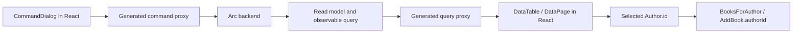

Build a library screen where a librarian can list authors, register an author, select one to see their books, and add a book to that author. This is the command/query UI path through **Cratis Platform**: Arc supplies the backend contracts and generated browser proxies; Components supplies the React forms, tables, dialogs, and page composition.

You will write the fields, columns, actions, and selection handoff. Components handles form binding and query subscriptions. It does not create your backend, generate its proxies, or make a successful command and an updated query result the same event.

## Before you start

1. Complete the [Arc library tutorial through Relate your slices](/arc/tutorial/books-and-relationships/). Keep its backend running and regenerate the TypeScript proxies after backend changes. This tutorial uses that application's contracts, not mock classes that you should copy into a new React project.
2. Follow [Getting started](/components/getting-started/) for the package peers, CSS entry file, and the nested `<Arc>` / `CratisComponentsProvider` setup. Keep the Arc host and development-server routing configuration from your application.
3. Check the generated files below in your frontend's `src/` directory. Names and paths are part of the handoff between the two tutorials.

| Generated file | Exports used here | Contract |
| --- | --- | --- |
| `src/Authors/Author.ts` | `Author`, `AllAuthors` | Author rows with `id` and `name`; an observable list query |
| `src/Authors/RegisterAuthor.ts` | `RegisterAuthor` | Command with required `id` and `name` |
| `src/Books/Book.ts` | `BooksForAuthor` | Observable books query taking `{ authorId }`; rows include `id` and `title` |
| `src/Books/AddBook.ts` | `AddBook` | Command with required `authorId`, `bookId`, and `title` |

If these files or exports are missing, return to the Arc tutorial and proxy generation before writing the screen. The handwritten files below live alongside the generated folders; do not edit generated files to repair an import.

## Follow the data through the screen

The proxies execute in the browser, using runtime configuration from `<Arc>`. The backend owns validation, authorization, writes, and query results. Components renders the state delivered by those proxies.

Command success closes the command dialog. The author or book becomes visible separately, when the observable query delivers a result containing it. There is no fixed delay promised by the UI.

:::note[Chronicle is not required]
The Arc tutorial uses MongoDB or EF Core directly and observes database changes. With an Arc backend using Chronicle, a projection must update the read model before its query can report the new row. Components does not subscribe directly to Chronicle. A local-array or presentational Components surface can also be used without this backend workflow; see [Choosing a component](/components/choosing-a-component/).
:::

## Build in three checkpoints

1. **[List the authors](./list-it.mdx).** Create `src/Authors.tsx`, mount it inside the providers, and distinguish loading, empty, failed, unauthorized, and populated results.
2. **[Act on the list](./act-on-it.mdx).** Create `src/AddAuthor.tsx`, open it with `useDialog`, and supply the hidden command `id` before validation. Confirm command completion and later row visibility separately.
3. **[List and detail](./list-and-detail.mdx).** Create `src/AuthorDetails.tsx` and `src/AddBook.tsx`, then replace `src/Authors.tsx` with a `DataPage`. Pass the selected author's `id` to both the books query and the add-book command.

Each chapter replaces or adds the named files; it is not a second application. At the end, use the [list-screen recipe](/components/list-screen-with-actions/) as a compact reminder rather than maintaining another copy of the screen.

If the first checkpoint fails, start with [Troubleshooting](/components/troubleshooting/): provider/routing failures belong to the Arc connection, unstyled output to the CSS entry, and a disabled submit button to command values and validity. [Start with the author table →](./list-it.mdx)
