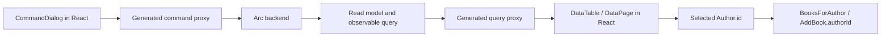

Build an Arc-backed React library screen with Cratis Components, starting with a table of authors. Then add a dialog to register an author and a detail panel that shows the selected author's books, with an action to add another book. Arc supplies the backend commands and queries and generates their TypeScript proxies, the browser classes your screen uses to call them. Components supplies the forms, tables, dialogs, and page layout.

You will write the fields, columns, and actions, then pass the selected author's identifier to the books panel. Components handles form binding and query subscriptions. Bring the backend and generated proxies from the Arc tutorial; completing a command and receiving an updated query result remain separate checkpoints.

## Before you start

1. Complete the [Arc library tutorial through Relate your slices](/arc/tutorial/books-and-relationships/). Keep its backend running and regenerate the TypeScript proxies after backend changes. This tutorial uses that application's contracts, not mock classes that you should copy into a new React project.
2. Follow [Getting started](/components/getting-started/) for the package peers, CSS entry file, and the nested `<Arc>` / `CratisComponentsProvider` setup. Keep the Arc host and development-server routing configuration from your application.
3. Check the generated files below in your frontend's `src/` directory. These are the .NET/JVM proxy paths used by the examples. Arc's TypeScript backend generates different `*.proxy.ts` paths; use its imports from [the first slice](/arc/tutorial/first-slice/) and [book relationship chapter](/arc/tutorial/books-and-relationships/) instead.

| Generated file | Exports used here | Contract |
| --- | --- | --- |
| `src/Authors/Author.ts` | `Author`, `AllAuthors` | Author rows with `id` and `name`; an observable list query |
| `src/Authors/RegisterAuthor.ts` | `RegisterAuthor` | Command with required `id` and `name` |
| `src/Books/Book.ts` | `BooksForAuthor` | Observable books query taking `{ authorId }`; rows include `id` and `title` |
| `src/Books/AddBook.ts` | `AddBook` | Command with required `authorId`, `bookId`, and `title` |

If these files or exports are missing, return to the Arc tutorial and proxy generation before writing the screen. The handwritten files below live alongside the generated folders; do not edit generated files to repair an import.

## Follow the data through the screen

The proxies execute in the browser, using runtime configuration from `<Arc>`. The backend owns validation, authorization, writes, and query results. A read model is the data a query reads. An observable query delivers later results as data changes; Components renders the state its proxy delivers.

Watch for two outcomes when you add an author or book. Command success closes the command dialog. The row becomes visible when the observable query delivers a result containing it. The UI does not promise a fixed delay between them.

:::note[Chronicle is not required]
The Arc tutorial uses MongoDB or EF Core directly and observes database changes. With an Arc backend using Chronicle, a projection must update the read model before its query can report the new row. Components does not subscribe directly to Chronicle. A local-array or presentational Components surface can also be used without this backend workflow; see [Choosing a component](/components/choosing-a-component/).
:::

## Build in three checkpoints

1. **[List the authors](./list-it.mdx).** Create `src/Authors.tsx`, mount it inside the providers, and distinguish loading, empty, failed, unauthorized, and populated results.
2. **[Act on the list](./act-on-it.mdx).** Create `src/AddAuthor.tsx`, open it with `useDialog`, and supply the hidden command `id` before validation. Confirm command completion and later row visibility separately.
3. **[List and detail](./list-and-detail.mdx).** Create `src/AuthorDetails.tsx` and `src/AddBook.tsx`, then replace `src/Authors.tsx` with a `DataPage`. Pass the selected author's `id` to both the books query and the add-book command.

Each chapter replaces or adds the named files; it is not a second application. At the end, use the [list-screen recipe](/components/list-screen-with-actions/) as a compact reminder rather than maintaining another copy of the screen.

Ready with the backend, proxies, and providers? [Start with the author table →](./list-it.mdx)

If a checkpoint fails, use [Troubleshooting](/components/troubleshooting/) to separate setup from data problems. Check the Arc connection for provider or routing failures, the CSS entry for unstyled output, and required command values and validity for a disabled submit button.
